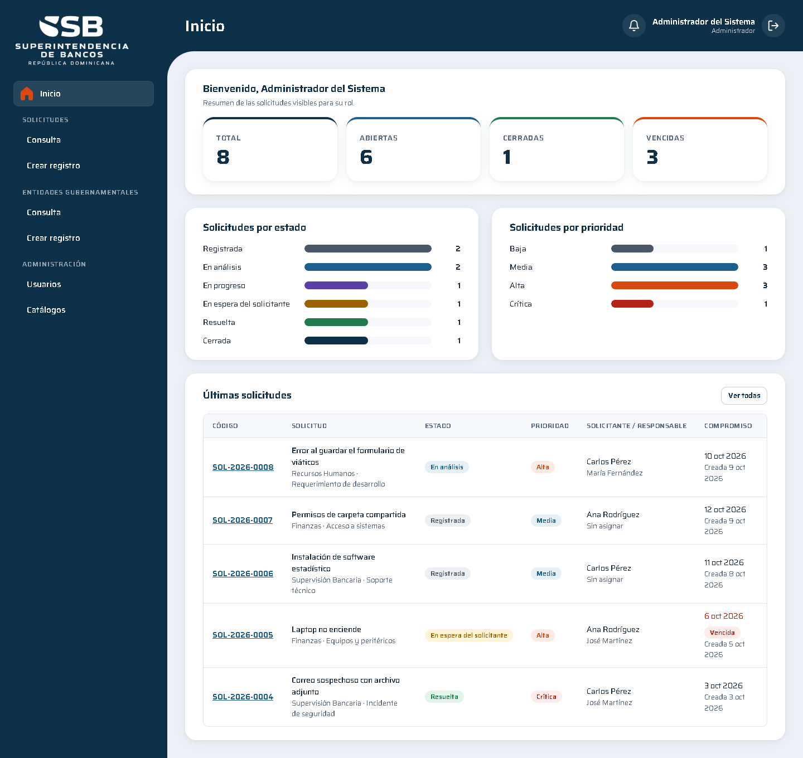

# SB.Solicitudes — Gestión de solicitudes internas y entidades gubernamentales

Solución full stack para la prueba técnica de la **Superintendencia de Bancos de la República Dominicana**:
registro, clasificación, asignación y seguimiento de solicitudes internas de servicios tecnológicos (estados con
historial, comentarios internos o públicos, notificaciones y tablero), más el **mantenimiento de entidades
gubernamentales** con base de datos en archivo de texto plano.

| | |
|---|---|
| Backend | .NET 8, ASP.NET Core Web API, EF Core 8, SQL Server 2022, SQLite, Serilog, OpenAPI (Swagger + Scalar), JWT |
| Frontend | React 18, TypeScript (strict), Vite, React Router, TanStack Query, react-hook-form + zod |
| Arquitectura | Onion: `SB.Solicitudes.Dominio` · `.Aplicacion` · `.Infraestructura` · `.Servicios` |
| Pruebas | 118 en backend (unitarias, arquitectura, integración con SQL Server real) y 39 en frontend |
| Entrega | Docker Compose, migraciones EF + scripts SQL, CI en GitHub Actions |

---

## Inicio rápido (Docker)

Requisito: Docker Desktop.

```bash
docker compose up --build
```

| Servicio | URL |
|---|---|
| Aplicación web | http://localhost:8080 |
| API (Production, la usa el frontend) | http://localhost:5080 |
| API de desarrollo + Scalar | http://localhost:5081/scalar (Swagger UI en http://localhost:5081/swagger) |
| Salud de la API | http://localhost:5080/health |
| SQL Server | `localhost,1433` (usuario `sa`, clave en `.env.example`) |

Ambos contenedores de la API salen de la misma imagen y solo cambian por `ASPNETCORE_ENVIRONMENT`: la documentación
interactiva se publica únicamente en `Development`. Cada uno usa su propia base de datos (`SBSolicitudes` y
`SBSolicitudesDev`). La API aplica las migraciones y los datos de ejemplo al arrancar. Los valores de `.env.example` son de
demostración; para cambiarlos copie el archivo a `.env`.

## Usuarios de prueba

Contraseña de todos: **`Demo2026*`**

| Correo | Rol | Qué puede hacer |
|---|---|---|
| `admin@solicitudes.local` | Administrador | Todo: solicitudes, usuarios, catálogos y entidades gubernamentales |
| `analista1@solicitudes.local` | Analista | Gestionar solicitudes asignadas a ella o sin asignar |
| `analista2@solicitudes.local` | Analista | Ídem |
| `solicitante1@solicitudes.local` | Solicitante | Crear y dar seguimiento a sus propias solicitudes |
| `solicitante2@solicitudes.local` | Solicitante | Ídem |

## Ejecución local sin Docker

Requisitos: SDK de .NET 8 o superior (`global.json` permite *roll forward*), Node.js 20+ y un SQL Server.

```bash
# 1. Base de datos (o use su propia instancia y ajuste ConnectionStrings:SolicitudesDatabase)
docker run -d --name sb-sql -e ACCEPT_EULA=Y -e "MSSQL_SA_PASSWORD=SbSolicitudes#Dev2026" -p 1433:1433 mcr.microsoft.com/mssql/server:2022-latest

# 2. API — en Development aplica migraciones y carga datos de ejemplo si la base está vacía
cd src/backend
dotnet run --project src/SB.Solicitudes.Servicios --launch-profile http     # http://localhost:5080/scalar

# 3. Frontend
cd src/frontend
npm install
npm run dev                                                                  # http://localhost:5173
```

### Base de datos

- **Migraciones EF Core** (recomendado): `dotnet tool restore` y luego
  `dotnet ef database update --context ApplicationDbContext --project src/SB.Solicitudes.Infraestructura --startup-project src/SB.Solicitudes.Infraestructura`
  (usa la variable `SB_SOLICITUDES_CONNECTION_STRING` o, si no existe, el SQL Server local del paso 1), o
  simplemente arrancar la API con `Database:ApplyMigrationsOnStartup=true` (activo en Development y Docker).
- **Script SQL**: `database/schema.sql` (tablas, índices y restricciones), idempotente y generado desde las
  migraciones, por lo que siempre coincide con el modelo.
- **Datos de ejemplo al primer arranque**: la API revisa cada tabla y solo la llena si está vacía (6 áreas, 5 tipos
  de solicitud, los 5 usuarios de prueba y 8 solicitudes con historial y comentarios, con fechas relativas al día de
  arranque). Nunca sobrescribe datos existentes; se desactiva con `Database:SeedOnStartup=false`.
- **SQLite** (fuente opcional de entidades gubernamentales): también con migraciones EF Core
  (`--context GovernmentEntitiesDbContext`), aplicadas automáticamente al arrancar.
- Motor: SQL Server 2019+ (probado con 2022). Las tablas y columnas usan los nombres en español del modelo de la
  prueba (`Solicitudes`, `HistorialEstados`, `FechaCompromiso`...).

### Configuración

Todo está en `src/backend/src/SB.Solicitudes.Servicios/appsettings.json` y se puede sobrescribir con variables de
entorno (`Seccion__Clave`):

| Clave | Uso |
|---|---|
| `ConnectionStrings:SolicitudesDatabase` | SQL Server de solicitudes |
| `ConnectionStrings:GovernmentEntitiesSqlite` | Base SQLite opcional de entidades gubernamentales |
| `Jwt:SigningKey` / `Issuer` / `Audience` / `ExpirationMinutes` | Emisión y validación del token (la llave se valida al arrancar, ≥ 32 caracteres) |
| `GovernmentEntities:DefaultSource` | Fuente por defecto: `TextFile`, `Sqlite` o `Excel` |
| `Notifications:Channels` | Canales activos: `InApp`, `Email` |
| `Notifications:Dispatch:EmailPickupDirectory` | Carpeta donde el correo simulado deja archivos `.eml` |
| `Database:ApplyMigrationsOnStartup` | Aplica migraciones al iniciar |
| `RateLimiting:LoginPermitsPerWindow` | Intentos de login por minuto e IP (5 por defecto) |

---

## Funcionalidad

**Solicitudes**
- Registro con título, descripción, tipo, prioridad, área, evidencia (texto o URL) y código legible
  `SOL-AAAA-NNNN` con consecutivo anual atómico.
- Consulta paginada en el servidor con filtros por estado, prioridad, área, tipo, solicitante, responsable, rango de
  fechas, texto y vencidas, y orden configurable.
- Estados: Registrada → En análisis → En progreso ⇄ En espera del solicitante → Resuelta → Cerrada, con tabla de
  transiciones explícita. Resolver, cerrar o reabrir exige comentario; solo Administrador o Analista reabren.
  Cada transición guarda fecha, usuario y comentario (historial visible en el detalle).
- Asignación y reasignación a analistas o administradores activos.
- Comentarios públicos o internos (el Solicitante nunca ve los internos).
- Notificaciones al crear, asignar, cambiar de estado, cerrar y comentar: en la aplicación (campana con
  contador) y por correo simulado.
- Tablero: totales, abiertas, cerradas, vencidas, distribución por estado y prioridad, y últimas solicitudes.
- Visibilidad por rol aplicada en el backend: Administrador ve todo; Analista, las asignadas a él, las libres y las
  propias; Solicitante, solo las suyas.

**Entidades gubernamentales** (mantenimiento de la maqueta)
- CRUD completo desde la interfaz (Consulta / Crear registro), con filtros por nombre (sin distinguir tildes),
  categoría, poder del Estado y sector.
- **Base de datos en archivo de texto plano** dentro del proyecto:
  `src/backend/src/SB.Solicitudes.Servicios/Data/entidades-gubernamentales.txt`. Si no existe o está vacío, en el
  primer arranque se crea con las 181 entidades del Excel oficial (`ListaEntidadesGubernamentales.xlsx`), que queda
  como fuente original de solo lectura.
- Patrón **Strategy + Factory**: el selector de fuente permite consultar el archivo de texto (por defecto), una base
  **SQLite** gestionada con EF Core o el **Excel original** (solo lectura). La importación copia el Excel a la fuente
  elegida.

**Administración**: usuarios (alta, rol, activación) y catálogos de áreas y tipos de solicitud.

## Endpoints principales

| Método | Ruta | Descripción |
|---|---|---|
| POST | `/api/auth/login` | Autenticación y emisión del JWT |
| GET | `/api/solicitudes` | Consulta paginada con filtros |
| POST | `/api/solicitudes` | Registro |
| GET | `/api/solicitudes/{id}` | Detalle con historial y comentarios |
| PATCH | `/api/solicitudes/{id}` | Edición parcial |
| PATCH | `/api/solicitudes/{id}/estado` | Cambio de estado |
| PATCH | `/api/solicitudes/{id}/asignacion` | Asignación o reasignación |
| POST | `/api/solicitudes/{id}/comentarios` | Comentario interno o público |
| GET | `/api/dashboard/resumen` | Métricas del tablero |
| GET | `/api/catalogos/areas`, `/api/catalogos/tipos-solicitud` | Catálogos activos (CRUD para administradores) |
| GET/POST/PUT/DELETE | `/api/entidades-gubernamentales[?source=]` | Mantenimiento de entidades |
| POST | `/api/entidades-gubernamentales/importaciones` | Importar una fuente a otra |
| GET | `/api/usuarios`, `/api/notificaciones` | Usuarios y bandeja de notificaciones |

El contrato se explora en Scalar o Swagger UI de la API de desarrollo y está exportado en
[`docs/api/openapi.json`](docs/api/openapi.json). Los errores siguen RFC 7807 (ProblemDetails) con un `code` estable y el `traceId`.

---

## Arquitectura

```
src/backend
├── src
│   ├── SB.Solicitudes.Dominio          Entidades, máquina de estados, eventos de dominio, Result
│   ├── SB.Solicitudes.Aplicacion       Casos de uso, validaciones, MediatR, puertos, visibilidad por rol
│   ├── SB.Solicitudes.Infraestructura  EF Core, SQL Server, SQLite, Excel, JWT, hasher de Identity, notificaciones
│   └── SB.Solicitudes.Servicios        API REST (host), seguridad, OpenAPI/Scalar, Serilog, Data/ (texto plano)
└── tests
    ├── SB.Solicitudes.Dominio.Tests
    ├── SB.Solicitudes.Aplicacion.Tests
    ├── SB.Solicitudes.Infraestructura.Tests
    ├── SB.Solicitudes.ArchitectureTests
    └── SB.Solicitudes.Servicios.IntegrationTests
src/frontend                            React + TypeScript (components, pages, services, types, hooks)
database                                schema.sql (los datos de ejemplo los carga la API al arrancar)
docs                                    arquitectura (ADR), evidencias, OpenAPI, respuestas conceptuales
```

Decisiones principales (detalle y justificación en [`docs/arquitectura.md`](docs/arquitectura.md)):

- **Onion** con dependencias hacia el centro, verificadas por pruebas de arquitectura.
- **MediatR 12.5.0** (última versión Apache-2.0) con *behaviors* de logging y validación.
- **Patrón Result** para errores de negocio y **ProblemDetails** en la API; excepciones solo para fallas técnicas.
- **Especificación de visibilidad por rol** que se traduce a SQL y se evalúa en memoria con la misma regla.
- **Eventos de dominio + outbox simplificado** para notificaciones: se guardan en la misma transacción y un
  *worker* las entrega por canal; cambiar de correo a cola es agregar una clase.
- **Strategy + Factory con keyed services** para las fuentes de entidades gubernamentales; Excel separado por
  interfaz de solo lectura.
- **Convenciones de la especificación** (PascalCase, camelCase, constantes en MAYÚSCULA, prefijo `I`, sin
  abreviaturas ni números mágicos) aplicadas como errores de compilación y verificadas por pruebas.

Convenciones de idioma: nombres de capas, rutas y tablas en español (tal como los nombra la prueba); el resto del
código en inglés; comentarios, commits y documentación en español.

## Pruebas

```bash
cd src/backend
dotnet test SB.Solicitudes.sln                                   # todo (integración requiere Docker)
dotnet test SB.Solicitudes.sln --filter "Category!=Integration"  # sin Docker

cd src/frontend
npm test
```

| Proyecto | Pruebas | Qué cubre |
|---|---|---|
| `Dominio.Tests` | 52 | Tabla de transiciones, comentario obligatorio, reapertura por rol, asignación, vencimiento, código, Result, reintentos de notificación |
| `Aplicacion.Tests` | 23 | Pipeline de validación, handlers con dobles, visibilidad SQL vs memoria, destinatarios de notificaciones, búsqueda e importación de entidades |
| `Infraestructura.Tests` | 14 | Archivo de texto (comillas y separadores, archivo editado a mano, concurrencia), SQLite con migraciones, lectura del Excel real, factory, hasher de claves, JWT, enmascarado de correos |
| `ArchitectureTests` | 12 | Dependencias entre capas y convenciones de nombres de la especificación |
| `Servicios.IntegrationTests` | 17 | API completa contra SQL Server 2022 en Testcontainers: login, roles, visibilidad, cierre con comentario y notificación, paginación, tablero, CRUD de entidades en las tres fuentes, carga inicial sin duplicados y creación del `.txt` desde el Excel |
| Frontend (Vitest) | 39 | Etiquetas, traducción de errores, esquemas zod, permisos por rol en la interfaz, cliente HTTP, login, navegación |

`scripts/validate.ps1` (o `validate.sh`) ejecuta lo mismo que los jobs de backend y frontend del CI.

## Integración continua y flujo de ramas

El trabajo se integra en `develop` y llega a `main` por pull request. `.github/workflows/ci.yml` corre en cada push a
`develop` o `main`, en cada PR hacia `main` y a demanda (`workflow_dispatch`):

| Job | Qué valida |
|---|---|
| Backend (.NET 8) | Build en Release, pruebas unitarias y de arquitectura, integración contra SQL Server en Testcontainers; publica los `.trx` |
| Frontend (React + TypeScript) | Lint, typecheck, Vitest (reporte JUnit publicado) y build de producción |
| Docker (stack completo) | `docker compose up --build`, salud de la API, login con usuario demo, datos semilla, frontend disponible y ningún contenedor como root |

Dependabot (`.github/dependabot.yml`) propone actualizaciones semanales de NuGet y npm y mensuales de Actions e
imágenes Docker, sin saltos de versión mayor en .NET ni en MediatR (la 13 es comercial).

## Evidencias

Capturas del flujo principal y guía de verificación en [`docs/evidencias.md`](docs/evidencias.md).



## Logs

Serilog escribe en consola y en `logs/solicitudes-AAAAMMDD.log` (rotación diaria, 14 días), con `TraceId` y `UserId`
en cada evento. No se registran contraseñas, tokens, valores de parámetros SQL ni correos completos.
