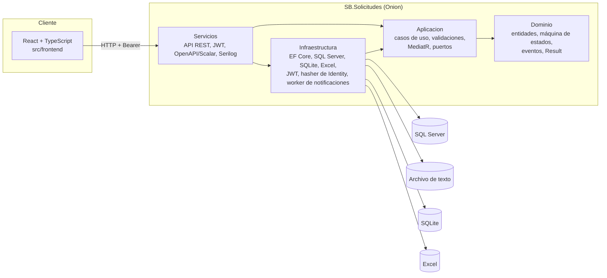
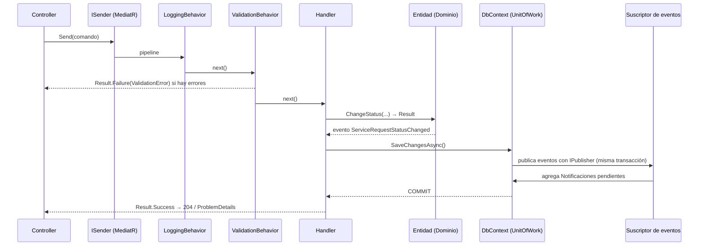

# Arquitectura y decisiones técnicas

Este documento justifica la estructura de la solución y registra las decisiones relevantes en formato ADR
(contexto → decisión → consecuencias). El objetivo es que quien mantenga el sistema entienda **por qué** está
construido así y qué costos se aceptaron.

## Vista general

| Proyecto | Responsabilidad | Depende de |
|---|---|---|
| `SB.Solicitudes.Dominio` | Entidades con invariantes (`ServiceRequest`, `StatusHistory`, `Comment`, `User`, `Area`, `RequestType`, `Notification`, `GovernmentEntity`), tabla de transiciones, eventos de dominio, `Result`/`Error`. | Nada |
| `SB.Solicitudes.Aplicacion` | Casos de uso (comandos y consultas), validaciones FluentValidation, MediatR con *pipeline*, especificación de visibilidad por rol, puertos (repositorios, generador de código, JWT, hasher, almacenes de entidades). | Dominio |
| `SB.Solicitudes.Infraestructura` | Implementaciones de los puertos: EF Core + SQL Server, migraciones, carga inicial de datos, generador `SOL-AAAA-NNNN`, JWT, `PasswordHasher` de Identity, canales y *worker* de notificaciones, almacenes de texto plano / SQLite / Excel. | Aplicacion |
| `SB.Solicitudes.Servicios` | Host de la API (los "servicios" REST): controllers, autenticación y *policies*, ProblemDetails, Serilog, OpenAPI (Swagger + Scalar), CORS, *rate limiting*. Es la raíz de composición. | Aplicacion, Infraestructura |

Las dependencias apuntan hacia el centro. `tests/SB.Solicitudes.ArchitectureTests` lo verifica en cada build:
Dominio y Aplicación no pueden referenciar EF Core, ASP.NET Core ni capas externas.

## Flujo de una petición

---

## ADR-001 · Onion en cuatro proyectos y "Servicios" como host de la API

**Contexto.** La especificación exige Onion con las capas Infraestructura, Aplicación, Servicios y Dominio, y
nombres `[SB].[NombreProyecto].[Capa]`. No define dónde vive el host HTTP.

**Decisión.** Cuatro proyectos `SB.Solicitudes.{Dominio,Aplicacion,Servicios,Infraestructura}`; *Servicios* es la
capa de servicios REST (host ASP.NET Core). Los nombres de capa van en español porque así los nombra la
especificación; el resto del código está en inglés.

**Consecuencias.** Se respeta literalmente la especificación sin agregar un quinto proyecto. Las reglas de
dependencia se comprueban con NetArchTest.

## ADR-002 · MediatR 12.5.0 como mediator

**Contexto.** Separar controllers de casos de uso y tener un punto único para validación y logging. MediatR cambió
a licencia comercial a partir de la versión 13 (2025).

**Decisión.** MediatR **12.5.0**, la última versión Apache-2.0, fijada en `Directory.Packages.props`. Sobre ella:
`ICommand`/`IQuery` (devuelven `Result<T>`) y sus handlers, que exponen `HandleAsync` para respetar el sufijo `Async`
de la especificación. *Behaviors*: `LoggingPipelineBehavior` (tiempo y resultado) y `ValidationPipelineBehavior`
(FluentValidation; crea el fallo con `IFailureFactory`, sin reflexión). Los eventos de dominio se publican con
`IPublisher` envueltos en `DomainEventNotification<T>`, de modo que el Dominio no referencia MediatR.

**Alternativas.** Un mediator propio (~100 líneas, se descartó: reinventa una librería conocida) y MediatR 13+
(exige licencia). Si el proyecto creciera, la migración natural es `Mediator` (generado en compilación, MIT).

**Consecuencias.** Controllers de una línea y un *pipeline* que cualquier desarrollador .NET reconoce; cubierto por
`MediatorPipelineTests` y las pruebas de integración.

## ADR-003 · Patrón Result para errores esperados

**Contexto.** Los errores de negocio (transición inválida, recurso no visible) son flujo normal, no excepciones.

**Decisión.** Dominio y Aplicación devuelven `Result`/`Result<T>` con un `Error` tipado (`ErrorType`, código
estable como `serviceRequest.commentRequired`). La API lo traduce a ProblemDetails (RFC 7807) con el código en
`extensions.code` y el `traceId`. Las excepciones quedan para fallas técnicas y las atiende un `IExceptionHandler`
global (concurrencia → 409, resto → 500 sin filtrar detalles internos).

**Consecuencias.** Contrato de errores consistente y fácil de traducir en el frontend; el dominio no conoce HTTP.

## ADR-004 · Visibilidad por rol como especificación única

**Contexto.** Administrador ve todo; Analista ve las asignadas a él, las libres y las propias; Solicitante solo las
suyas. La regla debe aplicarse igual en consultas SQL y en comandos.

**Decisión.** `ServiceRequestVisibility` expone `ToExpression()` (se traduce a SQL) y `CanView()` (en memoria).
Un test verifica que ambas coincidan en todos los escenarios. Si una solicitud no es visible se responde **404**,
no 403, para no revelar que existe. Los comentarios internos se filtran en la proyección para el Solicitante.

**Consecuencias.** Un solo lugar define la autorización por datos; las *policies* de ASP.NET Core cubren la
autorización por acción (defensa en profundidad: los handlers también la validan).

## ADR-005 · Notificaciones por eventos de dominio y outbox simplificado

**Contexto.** La prueba pide notificar al crear, asignar, cambiar estado y cerrar, y poder cambiar el mecanismo
(correo, cola) sin tocar la lógica de negocio.

**Decisión.**
1. Las entidades emiten eventos de dominio (`ServiceRequestCreated`, `Assigned`, `StatusChanged`, `CommentAdded`).
2. `ApplicationDbContext.SaveChangesAsync` despacha los eventos **antes** del commit; los suscriptores crean
   registros `Notificacion` pendientes en la **misma transacción** (no hay cambio sin notificación ni viceversa).
3. `NotificationDispatchWorker` (BackgroundService) entrega las pendientes a través de `INotificationDeliveryChannel`
   (en la aplicación y correo simulado que escribe archivos `.eml`), con reintentos y estado final `Failed`.

**Consecuencias.** Cambiar de correo a una cola (RabbitMQ, Service Bus) es agregar una clase que implemente
`INotificationDeliveryChannel` y un valor en `NotificationChannel`; los casos de uso no cambian. Con varias
instancias de la API habría que tomar el lote con `UPDLOCK, READPAST` (documentado como mejora).

## ADR-006 · Código legible `SOL-AAAA-NNNN`

**Decisión.** Tabla `ContadoresSolicitud (Anio, UltimoNumero)` y un `MERGE ... WITH (HOLDLOCK) ... OUTPUT` atómico
que reinicia el consecutivo cada año. Índice único sobre `Solicitudes.Codigo` como última barrera.

**Consecuencias.** Sin carreras entre peticiones concurrentes. Si una transacción posterior falla queda un hueco
en la numeración (igual que con un `SEQUENCE`), aceptable para un código de referencia.

## ADR-007 · Entidades gubernamentales: texto plano + Strategy/Factory

**Contexto.** La especificación pide que el mantenimiento use **un archivo de texto plano dentro del proyecto**.
Se agregó la posibilidad de consultar también SQLite y el Excel original.

**Decisión.**
- `IGovernmentEntityReader` (lo implementan las tres fuentes) e `IGovernmentEntityWriter` (solo texto y SQLite):
  segregación de interfaces, así Excel nunca simula una escritura (Liskov).
- La fábrica usa *keyed services* de .NET 8; el enum `GovernmentEntityDataSource` es la clave. Pedir un *writer*
  de Excel devuelve el error `governmentEntity.sourceReadOnly`, no una excepción.
- Fuente por defecto en `appsettings` (`TextFile`); el parámetro `source` permite elegir otra en la demo.
- Archivo `Data/entidades-gubernamentales.txt` delimitado por `|` y leído/escrito con CsvHelper (comillas,
  separadores y saltos de línea), con encabezado y escritura atómica
  (archivo temporal + `File.Move`), protegido con `SemaphoreSlim`.
- Excel leído por **nombre de encabezado** (no por posición) y cacheado mientras no cambie el archivo.
- SQLite se gestiona con migraciones EF Core propias (`GovernmentEntities/Migrations`, historial en
  `__EFMigrationsHistory`), igual que SQL Server; al arrancar se aplican con `MigrateAsync`.
- Al arrancar, si el texto o SQLite están vacíos se cargan desde el Excel; `POST .../importaciones` reemplaza una
  fuente con otra.
- El filtrado se hace en memoria (≈180 registros) para que las tres fuentes respondan idéntico, incluida la
  búsqueda sin distinguir mayúsculas ni tildes.

**Consecuencias.** Agregar una fuente es una clase y un registro. Si el catálogo creciera, el lector SQLite
debería filtrar en SQL.

## ADR-008 · EF Core con proyecciones; cuándo usar Dapper

**Decisión.** EF Core 8 para todo: migraciones, seguimiento de cambios en comandos, `AsNoTracking` + proyecciones
directas a DTO en consultas (solo las columnas necesarias), `AsSplitQuery` en el detalle, índices compuestos por
los filtros más usados, `rowversion` para concurrencia optimista y reintentos ante fallas transitorias.
El detalle de una solicitud expone esa versión (`version`, base64) y la edición, el cambio de estado y la
asignación la reenvían: si otro usuario guardó antes, la API responde 409 `serviceRequest.concurrencyConflict`
en lugar de pisar el cambio, y el frontend recarga los datos conservando lo que el usuario estaba escribiendo.
Un interceptor registra los comandos que superan un umbral configurable (`Database:SlowQueryThresholdMilliseconds`)
sin registrar valores de parámetros.

**Cuándo Dapper.** Reportes con SQL muy específico, consultas masivas de solo lectura o procedimientos
almacenados donde el mapeo explícito y el control total del SQL pesen más que la productividad de EF.

## ADR-009 · Enums como texto en la base de datos

**Decisión.** Estados, prioridades y roles se guardan como texto (legibles en consultas y scripts). Para ordenar
por significado de negocio (prioridad, flujo de estados) se usa una expresión `CASE`, no orden alfabético.
Las columnas son `varchar(50)` (`ENUM_MAXIMUM_LENGTH`): los nombres de los enums son ASCII, así que `varchar` ocupa
la mitad que `nvarchar` en la tabla y en los índices que las incluyen, y el miembro más largo (27 caracteres) deja
holgura para valores nuevos sin migrar. `StoreEnumsAsAsciiText` lo aplica a todas las propiedades enum del modelo,
para que ninguna configuración lo olvide; los textos libres (títulos, nombres, comentarios) siguen en `nvarchar`.
Renombrar un miembro sí exige migrar los datos guardados.

## ADR-010 · Seguridad

- JWT HS256 con `issuer`, `audience`, expiración y algoritmo validados; opciones verificadas al arrancar
  (`ValidateOnStart`, llave ≥ 32 caracteres). La llave se sobrescribe con la variable `Jwt__SigningKey`.
- Claves con el `PasswordHasher` de ASP.NET Core Identity (PBKDF2-HMAC-SHA512, sal aleatoria, formato versionado).
- Login con el mismo error para usuario inexistente o clave incorrecta (sin enumeración) y *rate limiting* por IP.
- Política por defecto: todo endpoint exige autenticación salvo `login` y `health`.
- Logs estructurados con usuario y `traceId`; nunca contraseñas, tokens ni valores de parámetros SQL; los correos
  se enmascaran (`a***@dominio`).

## ADR-011 · Convenciones de la especificación aplicadas por herramientas

Las reglas de nombres (PascalCase, camelCase, constantes en MAYÚSCULA, prefijo `I`) son **errores de compilación**
vía `.editorconfig` (`EnforceCodeStyleInBuild` + `TreatWarningsAsErrors`) y además las comprueba
`NamingConventionTests`. Los números mágicos se reemplazaron por constantes con nombre. Se desactivaron CA1707 y
CA1716 porque contradicen la propia especificación (guiones bajos en constantes, palabra `Error`), y CA1860 porque
la convención del proyecto es `!Any()` para colecciones vacías (en .NET 8 es O(1) sobre colecciones y arrays).

## ADR-012 · Datos de ejemplo cargados al arrancar, solo si faltan

**Contexto.** La revisión necesita usuarios y solicitudes de ejemplo sin pasos manuales, pero una semilla en la
migración (`HasData`) se aplica siempre, fija fechas que envejecen y no se puede volver a ejecutar sin riesgo.

**Decisión.** `DatabaseSeeder` corre al iniciar la API después de las migraciones y revisa tabla por tabla
(áreas, tipos, usuarios, solicitudes): solo inserta donde no hay datos. Las solicitudes se construyen con los
métodos del dominio (crear, asignar, cambiar estado, comentar), así respetan las mismas reglas que el uso real,
con fechas relativas al día de arranque para que haya abiertas, cerradas y vencidas. Se limpian sus eventos de
dominio para no generar notificaciones de ejemplo. Lo mismo aplica a las entidades gubernamentales: el archivo de
texto y SQLite se crean desde el Excel solo si están vacíos.

**Consecuencias.** Arrancar dos veces no duplica datos (cubierto por una prueba de integración). El archivo de
texto es un dato de ejecución y no se versiona; el Excel sí, como fuente original.

## ADR-013 · Carpetas por funcionalidad dentro de cada capa

**Contexto.** La especificación fija las cuatro capas Onion y sus nombres, pero no cómo se organiza cada proyecto
por dentro. La opción habitual en plantillas es agrupar por tipo técnico (`Dominio/Entities`, `Dominio/Errors`,
`Dominio/Enums`, `Aplicacion/Commands`, `Aplicacion/Validators`).

**Decisión.** Dentro de cada capa se agrupa por lo que cambia junto:

- **Dominio, por agregado.** `ServiceRequests/` reúne la entidad raíz, sus entidades internas (`Comment`,
  `StatusHistory`), sus enums, la tabla de transiciones, sus errores (`ServiceRequestErrors`) y sus eventos
  (`Events/`). Lo mismo `Users/`, `Catalogs/`, `Notifications/` y `GovernmentEntities/`. Solo lo compartido por
  todos va en `Common/` (`Entity`, `Result`, `Error`, `DomainGuard`).
- **Aplicación, en *vertical slices*.** Cada caso de uso tiene su carpeta con el comando o la consulta, su
  validador y su handler (`Features/ServiceRequests/ChangeServiceRequestStatus/`). Lo transversal (pipelines,
  mensajería, paginación, contratos de persistencia) está en `Abstractions/`.
- **Infraestructura y Servicios, por responsabilidad técnica** (`Persistence/Configurations`, `Repositories`,
  `Seed`, `Controllers`): ahí el tipo de pieza sí es lo que agrupa, porque no contienen reglas de negocio.

**Alternativas.** Carpetas por tipo técnico en todas las capas: más familiar para quien viene de plantillas
*Clean Architecture*, pero un cambio de negocio (por ejemplo, una transición de estado nueva) se reparte entre
`Entities/`, `Enums/` y `Errors/`, y entidades internas de un agregado como `Comment` aparecen al mismo nivel que
las raíces aunque solo se crean desde ellas (`Comment.Create` es `internal`).

**Consecuencias.** Un cambio de negocio se concentra en una carpeta y los límites de cada agregado se ven en el
árbol. A cambio, no hay una carpeta única con "todas las entidades". Las dependencias entre capas siguen
validadas por `ArchitectureTests`, que no dependen de la organización interna.

## Mejoras futuras identificadas

- *Refresh tokens* y revocación de sesiones.
- Bloqueo pesimista del lote de notificaciones para escalar horizontalmente el *worker*.
- Filtrado en SQL para el lector SQLite si el catálogo creciera.
- Auditoría genérica de cambios (interceptor que registre valores anteriores y nuevos).
- Pruebas end-to-end del frontend con Playwright.
