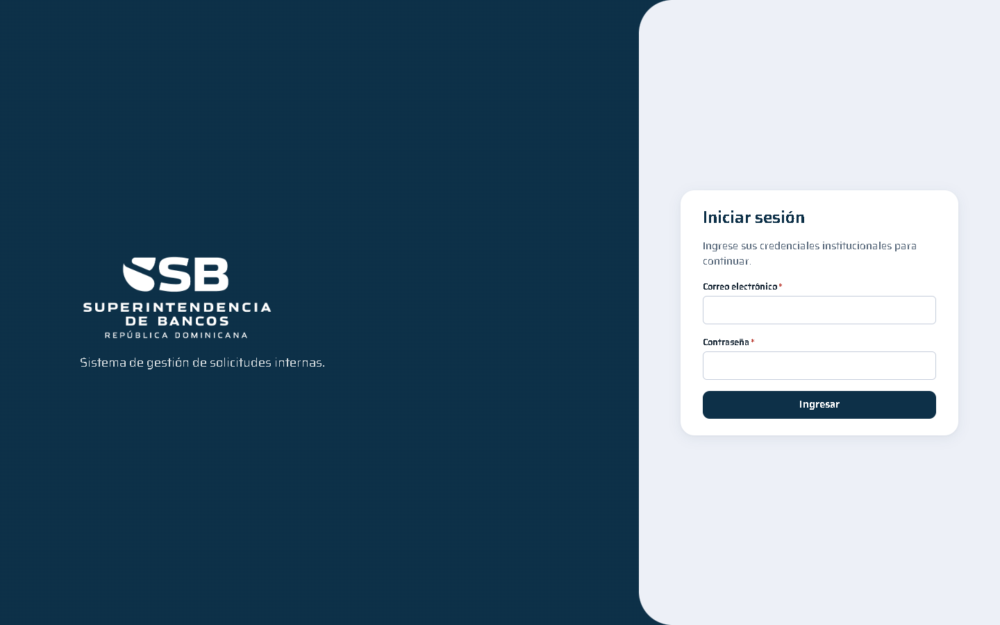
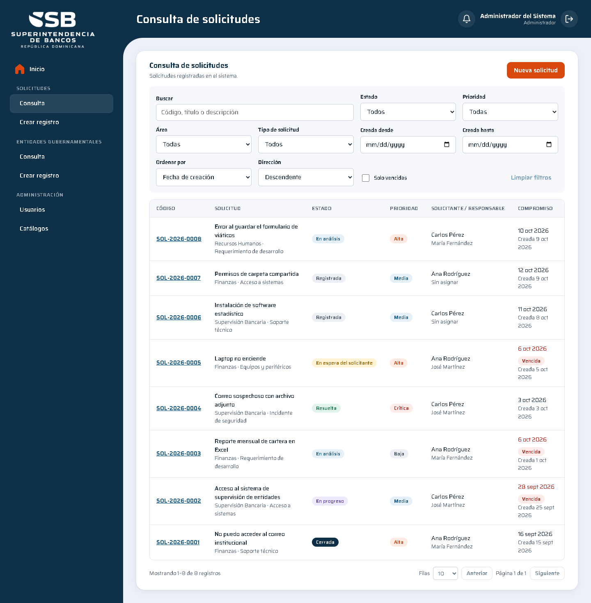
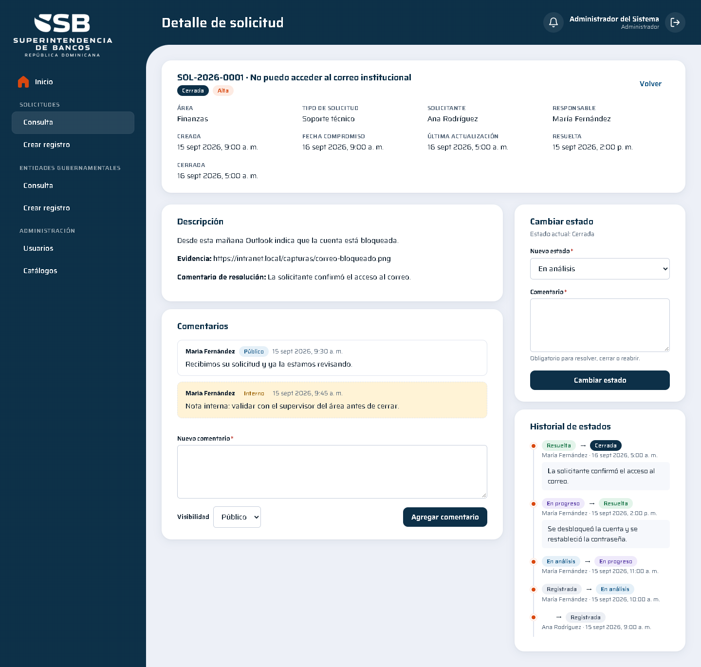
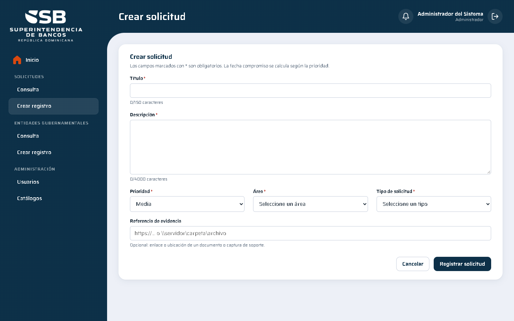
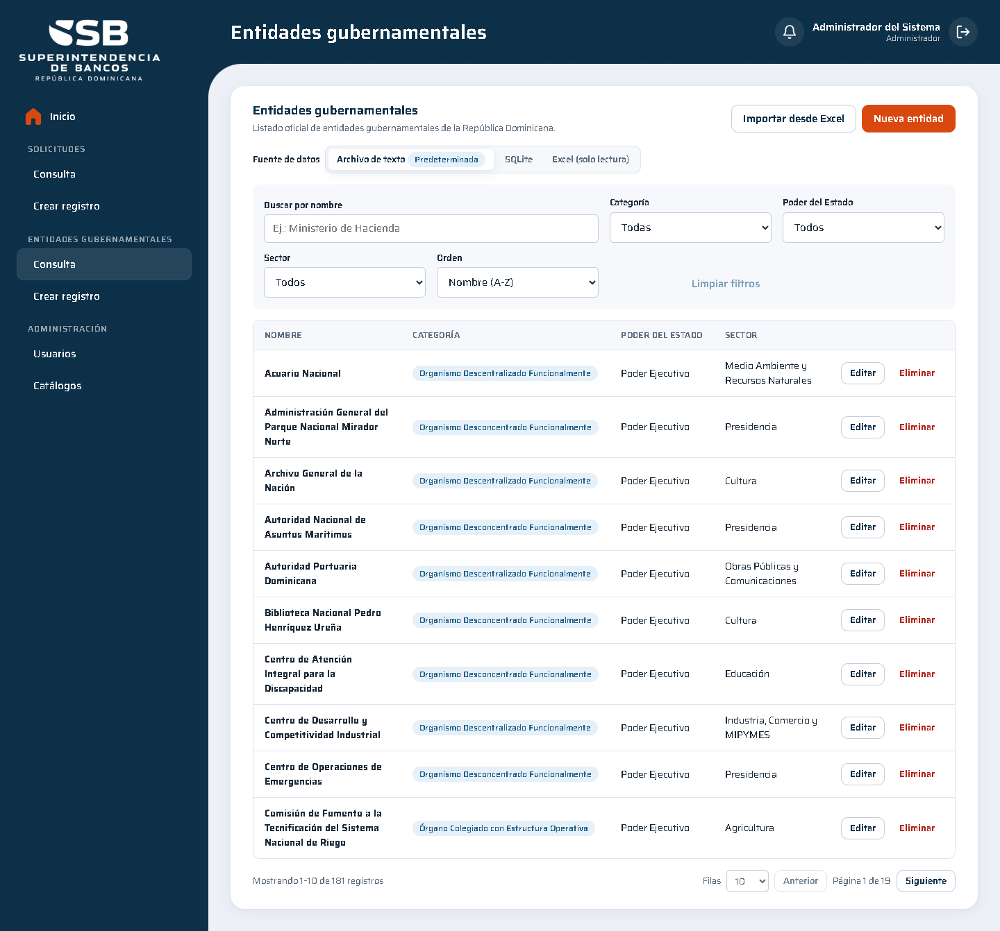
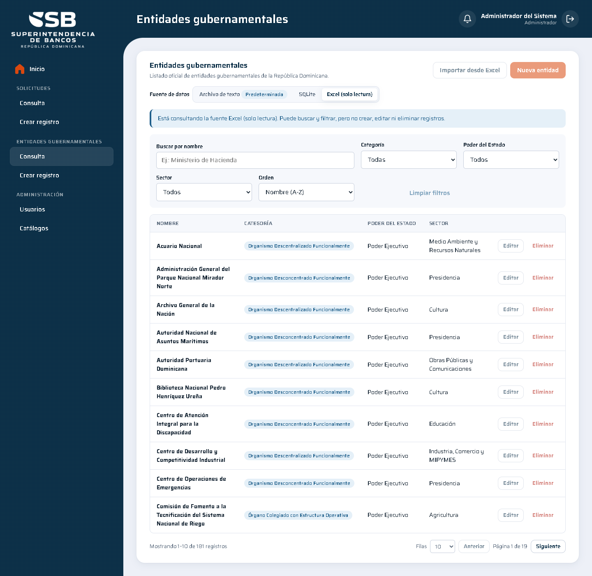
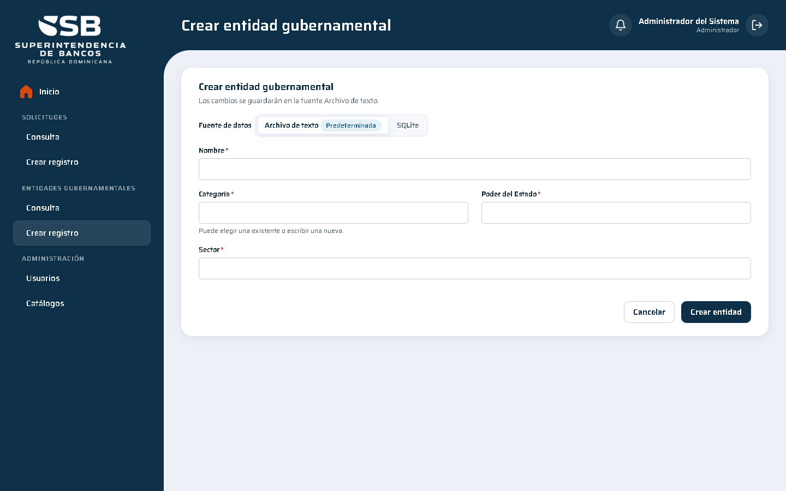
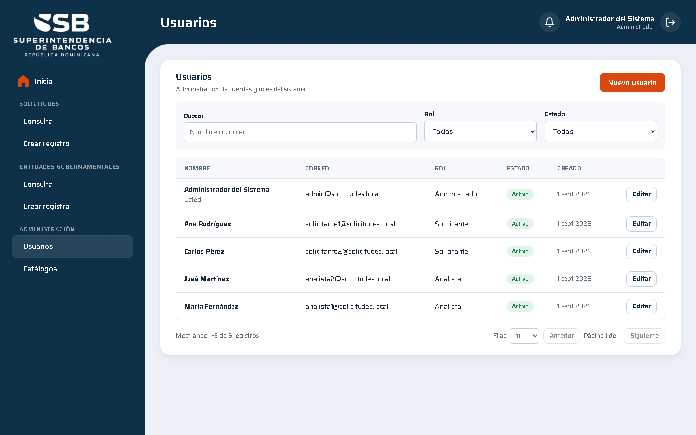
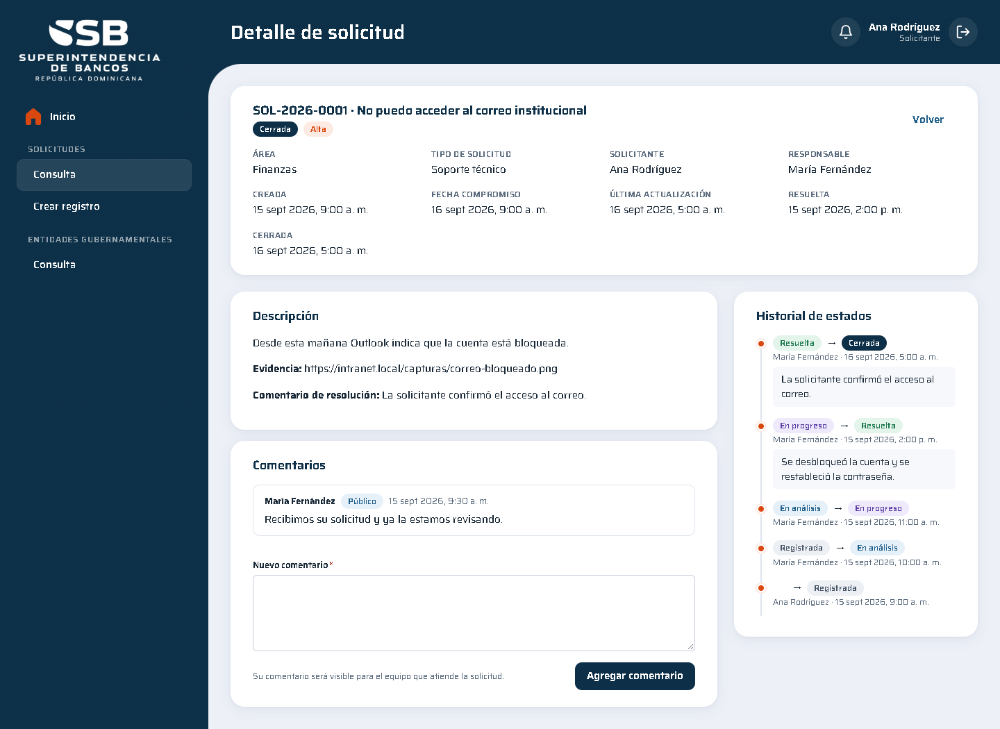

# Evidencias y guía del flujo principal

Capturas tomadas sobre la aplicación en ejecución (Chrome, 1440 px) con los datos de ejemplo que la API carga en el primer arranque.

## 1. Inicio de sesión



Cualquier usuario de la tabla del README con la clave `Demo2026*`. Credenciales inválidas muestran un mensaje
genérico (no se revela si el correo existe) y el login tiene límite de intentos por IP.

## 2. Tablero (Inicio)


Totales, abiertas, cerradas y vencidas; distribución por estado y por prioridad; últimas solicitudes con estado y
responsable. Las cifras respetan la visibilidad del rol.

## 3. Solicitudes · Consulta



Paginación y filtros resueltos en el servidor (estado, prioridad, área, tipo, fechas, texto, solo vencidas) y orden
configurable. Los filtros se conservan en la URL.

## 4. Solicitudes · Detalle



Historial de estados con usuario, fecha y comentario; comentarios públicos e internos; cambio de estado limitado a
las transiciones permitidas (con comentario obligatorio para resolver, cerrar o reabrir) y asignación de
responsable.

## 5. Solicitudes · Crear registro



Validaciones visibles que replican las del backend (obligatorios y longitudes máximas).

## 6. Entidades gubernamentales · Consulta (archivo de texto)



Fuente predeterminada: `Data/entidades-gubernamentales.txt`. Acciones de editar y eliminar para administradores.

## 7. Entidades gubernamentales · Consulta (Excel, solo lectura)



La misma vista sobre el Excel original: las acciones de escritura quedan deshabilitadas y la API las rechaza con
`governmentEntity.sourceReadOnly`.

## 8. Entidades gubernamentales · Crear registro



## 9. Administración · Usuarios



## 10. Vista del Solicitante



La misma solicitud del punto 4 vista por su solicitante: sin comentarios internos y sin acciones de gestión.

## Recorrido sugerido para la revisión

1. Entrar como `solicitante1@solicitudes.local` y crear una solicitud → aparece con código `SOL-AAAA-NNNN` y
   la campana muestra la notificación de registro.
2. Entrar como `analista1@solicitudes.local`, abrir la solicitud, asignarla a sí misma, pasarla a *En análisis*
   y luego intentar *Cerrada* sin comentario (se rechaza) y con comentario (se acepta).
3. Volver como solicitante: la campana muestra los cambios y el detalle conserva el historial completo.
4. Entrar como `admin@solicitudes.local` y en *Entidades gubernamentales* alternar entre las fuentes, crear,
   editar y eliminar una entidad en el archivo de texto, y comprobar que en Excel no se permite.
5. Revisar `src/backend/src/SB.Solicitudes.Servicios/simulated-mail/` (o el contenedor de la API) para ver los
   correos simulados generados.

## Pruebas e2e grabadas (Playwright)

41 casos de punta a punta sobre el stack de Docker, con un vídeo por caso (dos en los de concurrencia, uno por
navegador): sesión y expiración, filtros en la URL, diálogos y cambios sin guardar, concurrencia entre dos
usuarios, notificaciones, usuarios, errores de pantalla, móvil y cabeceras de entrega. El índice con los vídeos
está en [`evidencias/e2e/README.md`](evidencias/e2e/README.md).

Para ejecutarlos y regenerar los vídeos:

```bash
# Stack con el límite de login ampliado para la suite (la configuración normal permite 5 intentos por minuto)
docker compose -f docker-compose.yml -f docker-compose.e2e.yml up --build -d sqlserver api frontend

cd src/frontend
npx playwright install chromium ffmpeg   # o E2E_CHANNEL=msedge para usar el Edge instalado
npm run e2e                              # reporte HTML en e2e-report/
npm run e2e:evidence                     # copia los vídeos a docs/evidencias/e2e
```

La suite crea sus propios datos (solicitudes, usuarios y entidades con nombres únicos) y borra las entidades que
crea; tras ejecutarla conviene recrear la base para volver a los datos de ejemplo. En CI corre dentro del job
*Docker (stack completo)* y publica el reporte y los vídeos como artefacto.

